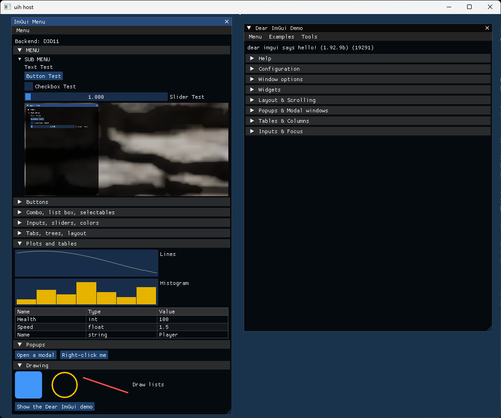
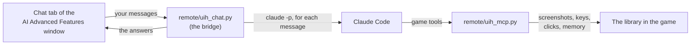
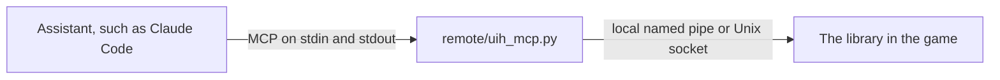

# Universal-Dear-ImGui-Hook

[](https://github.com/Sh0ckFR/Universal-Dear-ImGui-Hook/actions/workflows/build.yml)
[](https://github.com/Sh0ckFR/Universal-Dear-ImGui-Hook/releases/latest)
[](LICENSE)

A [Dear ImGui](https://github.com/ocornut/imgui) overlay that draws your interface inside another application, whatever graphics API it uses. The API is detected at runtime: build once, inject anywhere.

The overlay can also let an AI assistant such as Claude Code [see and play the game](#remote-control-by-an-ai-assistant) through MCP, and you can [chat with Claude from inside the game](#talk-to-claude-from-the-game).

| API | Windows (x86, x64) | Linux (x86-64, ARM64) |
| --- | --- | --- |
| Direct3D 9, 9Ex | :white_check_mark: | Windows DLL under Wine or Proton |
| Direct3D 10, 11, 12 | :white_check_mark: | Windows DLL under Wine or Proton |
| Vulkan | :white_check_mark: | :white_check_mark: |
| OpenGL 3.0+ | :white_check_mark: (WGL) | :white_check_mark: (GLX, EGL) |



> [!IMPORTANT]
> **Use it on single-player games and your own software.** Anti-cheat systems detect injected DLLs and can ban your account. While the remote control is on, any program running on your machine can control the game, and with the memory tools, read and write its memory.

## Contents

- [Features](#features)
- [Quick start](#quick-start)
- [Usage](#usage): [Windows](#windows), [Linux](#linux), [settings](#settings), [your menu](#writing-your-menu), [as a library](#using-the-hook-as-a-library)
- [Talk to Claude from the game](#talk-to-claude-from-the-game)
- [Remote control by an AI assistant](#remote-control-by-an-ai-assistant)
- [API](#api)
- [How it works](#how-it-works)
- [Building](#building)
- [Tests](#tests)
- [Contributing](#contributing)
- [Limitations](#limitations)
- [Credits](#credits), [Support](#support), [License](#license)

Sections marked with ▶ expand on click. What changed in each version is listed in the [releases](https://github.com/Sh0ckFR/Universal-Dear-ImGui-Hook/releases).

## Features

- **Chat with Claude in the game**: a [chat window over the game](#talk-to-claude-from-the-game) where you tell Claude what to do. It looks at the game, plays it, reads or changes its memory, and answers in the chat.
- **One library for every API**: the backend is picked from the first API that presents a frame. Inject before or after the game initializes its graphics.
- **AI remote control**: through [MCP](#remote-control-by-an-ai-assistant), an assistant such as Claude Code sees the game, shows messages to the player, presses keys and clicks. Your menu can give it [tools of your own](#tools-of-your-own), such as *teleport* or *spawn an item*, which it calls like the built-in ones. With the [advanced features](#advanced-features-and-the-ai-advanced-features-window), it also types text, drags the mouse, waits for the screen to change, follows pointer chains, freezes values and finds the code that writes them, and the *AI Advanced Features* window shows everything it does.
- **Menu input**: `INSERT`, or L3 + R3 on a controller, opens the menu; `F11` removes the overlay and unloads the DLL. Both keys are [settings](#settings). While the menu is open, the game receives no keyboard, mouse or controller input (on Linux, no key or button presses and no motion), and an XInput controller navigates the menu.
- **The overlay can't crash the game** (MSVC builds on Windows, and Linux): an access violation or a C++ exception in the overlay, whether in a renderer backend or in your menu code, removes the overlay instead of taking the game down. The menu key brings it back.
- **Images and frame capture**: `uih::CreateTexture()` turns RGBA pixels into an image for `ImGui::Image()`, and `uih::CaptureFrame()` copies the game's frame, without the overlay, on every backend.
- **Multiple windows**: when the game presents to more than one window or swap chain, the overlay stays on one of them and follows the focus.
- **Readable on any display**: the interface follows the game window's DPI, or a fixed scale, with correct colors on sRGB and floating-point back buffers.
- **No injector needed**: the DLL can be loaded as `dinput8.dll`, and the Linux library with `LD_PRELOAD`.
- **No dependencies**: Dear ImGui, MinHook and the Vulkan headers are vendored, and the C and C++ runtimes are linked statically.
- **Tested in real games**: on every commit, the CI loads the library into [DDNet](https://ddnet.org/) and a [Godot](https://godotengine.org/) project on Windows and Linux, with Direct3D 11, Direct3D 12, Vulkan and OpenGL, and plays them through the MCP server on Linux.

## Quick start

**1. Get the library.** Prebuilt libraries are attached to each [release](https://github.com/Sh0ckFR/Universal-Dear-ImGui-Hook/releases), and every commit's builds are kept as [workflow artifacts](https://github.com/Sh0ckFR/Universal-Dear-ImGui-Hook/actions). Pick the one that matches the **game**, not your machine:

| Game | File |
| --- | --- |
| Windows, 64-bit | `Universal-ImGui-Hook-msvc-x64.dll` |
| Windows, 32-bit | `Universal-ImGui-Hook-msvc-Win32.dll` |
| Linux, x86-64 or ARM64 | `Universal-ImGui-Hook-linux-x86_64.so` or `-linux-aarch64.so` (glibc 2.28 or later) |

These are the `Universal-ImGui-Hook.dll` and `.so` that the build below produces, renamed after their platform; the rest of this page uses the short name.

Each release lists the SHA256 of its libraries in `SHA256SUMS`, and GitHub attests that this repository's CI built them: `gh attestation verify Universal-ImGui-Hook-msvc-x64.dll --repo Sh0ckFR/Universal-Dear-ImGui-Hook` checks a file you downloaded.

**2. Or build it.** On Windows, open `Universal-ImGui-Hook.sln` in Visual Studio 2022 or newer and build `Release|x64` (`Release|Win32` for a 32-bit game): the DLL is `build/vs/x64/Release/Universal-ImGui-Hook.dll` (`build/vs/x86/Release/` for Win32). On Linux:

```sh
sudo apt install cmake ninja-build g++ pkg-config libxcb1-dev
cmake --preset linux && cmake --build --preset linux
LD_PRELOAD=$PWD/build/linux/Universal-ImGui-Hook.so ./game
```

**3. Make it yours.** You only edit the example; the hook itself, in `src/`, needs no changes:

| To change | Edit |
| --- | --- |
| The menu | `example/menu.cpp`, plain Dear ImGui code run every frame |
| Hotkeys, controller buttons, graphics API, interface scale | `example/config.cpp` |
| AI remote control and its pipe or socket name | `example/config.cpp`: see [Remote control by an AI assistant](#remote-control-by-an-ai-assistant) |
| Tools of your own for the assistant | `RegisterExampleTools()` in `example/menu.cpp`: see [Tools of your own](#tools-of-your-own) |
| Fonts and style | a `config.setup` callback, run when the ImGui context is created, set next to `config.render` in `example/dllmain.cpp` (Windows) or `example/preload.cpp` (Linux) |

## Usage

### Windows

Inject `Universal-ImGui-Hook.dll` with any injector, with `LoadLibrary`, or with the script of this repository (see [step 2](#step-2-load-the-library-into-the-game) of the chat). `F11` unloads an injected DLL; inject it again to bring the overlay back.

To load it without an injector, rename it to `dinput8.dll` and put it next to the game's executable. It exports `DirectInput8Create` and forwards it to the system library, so any game that imports DirectInput 8 loads it. Under Wine or Proton, add `WINEDLLOVERRIDES="dinput8=n,b" %command%` to the launch options. Loaded this way, the DLL stays in the game, which holds a reference to it: `F11` removes the overlay and `INSERT` brings it back.

Logs (`config.debugLog`) go to `OutputDebugString`; read them with [DebugView](https://learn.microsoft.com/sysinternals/downloads/debugview). The example DLL writes them when the game runs with the environment variable `UIH_DEBUG=1`.

### Linux

```sh
LD_PRELOAD=/path/to/Universal-ImGui-Hook.so ./game
```

For a Steam game, set the launch options to `LD_PRELOAD=/path/to/Universal-ImGui-Hook.so %command%`. `UIH_DEBUG=1` prints the log on stderr. A preloaded library cannot leave the process: `F11` removes the overlay and its hooks, and `INSERT` brings them back.

**Steam Deck.** SteamOS is Linux: for a native game, set its launch options to `LD_PRELOAD=/path/to/Universal-ImGui-Hook.so %command%`. For a Windows game running under Proton, use the Windows DLL as `dinput8.dll` next to the game's executable, with `WINEDLLOVERRIDES="dinput8=n,b" %command%` in the launch options (see [Windows](#windows)). The controller buttons that open the menu (`menuButtons`) are read through XInput, which only the Windows DLL uses: in a native game, bind the menu key, `INSERT` by default, to a button of the Deck with Steam Input.

### Settings

The example library's settings are compiled into it: edit `example/config.cpp`, next to `dllmain.cpp`, and rebuild.

```cpp
void ApplySettings(uih::Config& config) {
    config.menuKey = VK_INSERT;                              // opens and closes the menu
    config.unloadKey = VK_F11;                               // removes the overlay, unloads the DLL
    config.menuButtons = uih::GamepadL3 | uih::GamepadR3;    // controller buttons held together, 0 to disable
    config.backend = uih::Backend::None;                     // graphics API to hook, None detects it
    config.scale = 0.0f;                                     // interface size, 0 follows the DPI
    config.remoteControl = false;                            // AI remote control
    config.remotePipe = "universal-imgui-hook";              // name of its pipe (Windows) or socket (Linux)
    config.remoteMemory = false;                             // memory tools of the remote control
    config.aiAdvancedFeatures = false;                       // advanced tools and the AI Advanced Features window
}
```

<details>
<summary>Values of each setting</summary>

| Setting | Values |
| --- | --- |
| `menuKey`, `unloadKey` | Windows: [virtual-key codes](https://learn.microsoft.com/windows/win32/inputdev/virtual-key-codes) such as `VK_F1` or `'M'`. Linux: X11 keysyms from `X11/keysymdef.h`, such as `0xffbe` for `XK_F1`; the file has its own `#else` branch for them. `0` disables the key. |
| `menuButtons` | `uih::GamepadA`, `B`, `X`, `Y`, `L1`, `R1`, `L3`, `R3`, `Start`, `Back`, `DpadUp`, `DpadDown`, `DpadLeft`, `DpadRight`, combined with `\|`; first XInput controller, Windows only. |
| `backend` | `uih::Backend::None` detects the API from the first one that presents a frame, which is right for nearly every game. `D3D9`, `D3D10`, `D3D11`, `D3D12`, `Vulkan` or `OpenGL` forces one, for a game that uses several. |
| `scale` | `0` follows the DPI of the game window; `1.5` draws the interface at 150%. |
| `remoteControl`, `remotePipe` | `true` serves the [remote control](#remote-control-by-an-ai-assistant) on the named pipe `\\.\pipe\<remotePipe>` on Windows, or the Unix socket `$XDG_RUNTIME_DIR/<remotePipe>` on Linux. |
| `remoteMemory` | `true`, with `remoteControl`, also gives the assistant the [memory tools](#memory-tools): modules, read, write, value and pattern scans. |
| `aiAdvancedFeatures` | `true`, with `remoteControl`, gives the assistant the [advanced tools](#advanced-features-and-the-ai-advanced-features-window) and adds the *AI Advanced Features* button to the menu; the advanced memory tools also need `remoteMemory`. |

</details>

### Writing your menu

The interface lives in `example/menu.cpp`. `DrawMenu()` is called every frame between `ImGui::NewFrame()` and `ImGui::Render()`, so any Dear ImGui code works there. The entry points, `example/dllmain.cpp` on Windows and `example/preload.cpp` on Linux, apply the settings and start the hook:

```cpp
uih::Config config;
ApplySettings(config);         // example/config.cpp
config.render = DrawMenu;      // every frame
config.setup = LoadFonts;      // when the ImGui context is created: fonts, style
config.module = module;        // Windows: DLL unloaded by unloadKey
uih::Start(config);
```

Images are created once from RGBA pixels and drawn like any ImGui texture:

```cpp
static ImTextureData* logo = uih::CreateTexture(pixels, 64, 64);
ImGui::Image(logo->GetTexRef(), ImVec2(64, 64));
```

The example menu is a tour of the common widgets (buttons, combo and list boxes, inputs, sliders, colors, tabs, trees, tables, plots, popups, draw lists), with `imgui.png` shown under the slider. Its *Menu* bar opens Dear ImGui's own demo window, which covers every function. `example/image.cpp` embeds the picture in the library and decodes it with [stb_image](https://github.com/nothings/stb).

### Using the hook as a library

The repository is a CMake package. Link `uih::uih` to get `include/uih.h` and Dear ImGui's headers:

```cmake
include(FetchContent)
FetchContent_Declare(uih
    GIT_REPOSITORY https://github.com/Sh0ckFR/Universal-Dear-ImGui-Hook.git
    GIT_TAG v2.1.0)   # a release tag, for reproducible builds
FetchContent_MakeAvailable(uih)
target_link_libraries(my_overlay PRIVATE uih::uih)
```

`tests/consumer/` is a complete example, built by the CI. On Linux, linking `uih::uih` into a shared library applies `src/linux/exports.map`, which exports only the hooked functions.

## Talk to Claude from the game

Chat with [Claude](https://claude.com/claude-code) in a window drawn over the game: ask it what it sees, or tell it what to do. It looks at the game, plays it, reads or changes its memory, and answers in the chat as it works.



### What you need

| | |
| --- | --- |
| **Claude Code** | [Installed](https://claude.com/claude-code) and signed in: `claude` must start in a terminal. The chat uses your Claude Code plan. |
| **Python** | 3.8 or newer, from [python.org](https://www.python.org) on Windows. Nothing to install with `pip`. The commands below use `python`; on Linux, type `python3`. |
| **This repository** | Cloned, to build the library and run the scripts in `remote/`. |
| **A single-player game** | Anti-cheat systems detect injected DLLs. |

### Step 1: build the library with the chat on

In `example/config.cpp`, set these settings to `true`:

```cpp
config.remoteControl = true;        // the game can be controlled through a local pipe or socket
config.remoteMemory = true;         // optional: Claude can read and change the game's memory
config.aiAdvancedFeatures = true;   // the AI Advanced Features window and its chat
```

Then build. On Windows, open `Universal-ImGui-Hook.sln` in Visual Studio and build `Release|x64` (`Release|Win32` for a 32-bit game), which produces `build/vs/x64/Release/Universal-ImGui-Hook.dll` (`build/vs/x86/Release/` for Win32). On Linux, `cmake --preset linux && cmake --build --preset linux` produces `build/linux/Universal-ImGui-Hook.so`.

### Step 2: load the library into the game

**Windows**: the DLL must be loaded into the game, by any means. **If it already is**, with your own injector or as `dinput8.dll` next to the game, skip to the check below. Otherwise, start the game, wait for its window, then run this in a terminal opened in the repository:

```sh
python remote/uih_mcp.py inject game.exe build/vs/x64/Release/Universal-ImGui-Hook.dll
```

`game.exe` is the process name shown in the Task Manager (*Details* tab), or its PID. Give the process that shows the game window, not its launcher. `inject` only loads the DLL and exits: nothing else needs it.

**Linux**: start the game with the library preloaded:

```sh
LD_PRELOAD=$PWD/build/linux/Universal-ImGui-Hook.so /path/to/game
```

The socket opens with the overlay's first frame, in the process that draws it, not in the launch scripts that preload the library too.

The overlay shows up with the menu open: that is how you know the library is loaded. To check that the game also answers on its pipe or socket, however the library got in:

```sh
python remote/uih_mcp.py check
```

```text
The game answers on universal-imgui-hook. Graphics API: Vulkan, window 1024x768, keyboard focus: True, overlay menu open: True, memory tools: on, advanced tools: on.
```

Add `--pipe <name>` if `config.remotePipe` is not the default.

### Step 3: start the bridge

In a terminal opened in the repository, which you leave open while you play:

```sh
python remote/uih_chat.py
```

It prints `Connected` once it has found the game. Start it before or after the game, in any order: it waits for the game, and for it to come back after a restart.

You never start `remote/uih_mcp.py` yourself for the chat: the bridge hands it to Claude Code, which starts it for each answer. Run without arguments, it is an MCP server waiting for a client on its standard input, and does nothing on its own.

### Step 4: chat

In the game, press `INSERT` to open the menu, click **AI Advanced Features**, and stay on the **Chat** tab. The top of the tab says **Claude is listening** in green. Type, then press Enter:

- *What do you see?*
- *Find my health and keep it at 100.*
- *Walk to the door and open it.*
- *Type "gg" in the game's chat.*
- *Why can't I buy this item?*

Claude writes in the chat as it works, and the line *Claude is working* shows which tool it is using. **Stop** ends its answer, and **New conversation** makes it forget what was said. To play, Claude closes the menu, since the game gets no keys or clicks while it is open; its answers then show at the top of the screen, and `INSERT` brings the chat back.

### Bridge options

| Option | Default | Effect |
| --- | --- | --- |
| `--pipe <name>` | `universal-imgui-hook` | The game's `config.remotePipe`, if you changed it |
| `--model <model>` | Claude Code's default | `sonnet` answers faster, `opus` thinks more |
| `--claude <path>` | `claude` on the `PATH` | The Claude Code executable |

Each message runs Claude Code headless (`claude -p`) with the tools of `remote/uih_mcp.py` and no other tool: no shell, no file access. It runs from its own folder in the temporary directory, so none of your `CLAUDE.md` files apply, and the conversation is kept there until **New conversation**.

### Troubleshooting

| You see | Do |
| --- | --- |
| `INSERT` shows nothing | The library is not in the game: inject it into the process that shows the window, with the same architecture (x64 DLL for a 64-bit game). Some launchers start the game as a second process, such as Godot's `_console.exe`. |
| The bridge stays on `Waiting for the game` | Same as above, or `config.remoteControl` is `false`, or another game already holds the pipe: close it, or give each game its own `remotePipe` and `--pipe`. |
| `The game refuses the chat` | `config.aiAdvancedFeatures` is `false`: set it and rebuild. |
| **Claude is not connected** in the chat | The bridge is not running, or runs with another `--pipe`. |
| `Claude Code is not on the PATH` | Install Claude Code, or give its path with `--claude`. |
| `Claude Code failed` in the chat | Run `claude` once in a terminal and sign in. |
| Claude cannot press keys or read the memory | The switches at the top of the window are off, or `config.remoteMemory` is `false`. |

## Remote control by an AI assistant

The library can let an AI assistant such as [Claude Code](https://claude.com/claude-code) see the game, show messages to the player, press keys and click, and optionally read and write the game's memory. The assistant speaks the [Model Context Protocol](https://modelcontextprotocol.io) (MCP) with `remote/uih_mcp.py` over standard input and output, and the script talks to the library over a local named pipe (Windows) or Unix socket (Linux). It works with every graphics API, and on Linux with X11 and XWayland games.



**1. Turn it on and load the library into the game**, as in steps [1](#step-1-build-the-library-with-the-chat-on) and [2](#step-2-load-the-library-into-the-game) of the chat. Only `config.remoteControl` is required: `remoteMemory` adds the memory tools, and `aiAdvancedFeatures` adds the advanced tools and their window. `config.remotePipe` names the pipe, `\\.\pipe\universal-imgui-hook` by default, or the socket, `$XDG_RUNTIME_DIR/universal-imgui-hook`. `python remote/uih_mcp.py check` tells you whether the game answers.

**2. Register the MCP server with the assistant**, once. You do not start `uih_mcp.py` yourself: the assistant does when a session starts, and talks to it over its standard input and output. With Claude Code:

```sh
claude mcp add game -- python C:/path/to/Universal-Dear-ImGui-Hook/remote/uih_mcp.py
```

On Linux, use `python3 /path/to/Universal-Dear-ImGui-Hook/remote/uih_mcp.py`. With another `remotePipe`, add `--pipe <name>` after the script. Other MCP clients, such as Claude Desktop, take the same command in their configuration:

```json
{
  "mcpServers": {
    "game": { "command": "python", "args": ["C:/path/to/Universal-Dear-ImGui-Hook/remote/uih_mcp.py"] }
  }
}
```

**3. Ask.** Start a new session of the assistant, or run `/mcp` in Claude Code, and talk about the game:

- *Look at the game and tell me what you see.*
- *Write "Well done!" in the game for 5 seconds.*
- *Walk right to the edge of the platform, then jump.*
- *Open the overlay menu and describe it.*
- *Click on "New game" in the main menu.*
- *Find my money in memory and set it to 99999.* (with `remoteMemory`)
- *Type "gg" in the chat, then wait for the next round to start.* (with `aiAdvancedFeatures`)
- *Find my health, keep it at 100, and find a pointer to it that survives a restart.* (with both)

### Tools

The assistant gets these tools:

| Tool | Effect |
| --- | --- |
| `screenshot` | The current frame, without the overlay, at most 1280 pixels wide or high by default |
| `show_text` | A message to the player at the top of the screen, drawn by the overlay, for 10 seconds by default |
| `press_key` | Holds keys for a duration, 150 ms by default; `right+space` holds them together |
| `click` | Clicks at a point of the last screenshot, with the left, right or middle button |
| `game_info` | Graphics API, window size, keyboard focus, menu state, and whether the memory and advanced tools are on |

### Memory tools

With `remoteMemory`, the assistant also gets memory tools, like those of a memory editor such as Cheat Engine:

| Tool | Effect |
| --- | --- |
| `memory_find`, `memory_next`, `memory_results` | Value scan of the writable memory (`i8` to `i64`, `f32`, `f64`), narrowed by a new value or by `changed`, `unchanged`, `increased`, `decreased`, with the module+offset of each address |
| `memory_read`, `memory_write` | Hexadecimal dump, with the first bytes decoded as numbers and as a pointer; writes a value or bytes, code included |
| `memory_pattern` | Byte pattern with `??` wildcards in a module, the executable by default |
| `memory_modules` | The game's modules with their base address and size |

Addresses are hexadecimal or `module+offset`, such as `game.exe+1a2b3c`. With `aiAdvancedFeatures`, they can also be pointer chains: `[game.exe+1a2b3c]+10` is the address 0x10 bytes after the one stored at `game.exe+1a2b3c`.

### Advanced features and the AI Advanced Features window

With `config.aiAdvancedFeatures = true`, the assistant also gets these tools:

| Tool | Effect |
| --- | --- |
| `type_text` | Types Unicode text, for chat boxes and text fields; a new line presses Enter |
| `mouse_move`, `drag` | Moves the cursor to a point of the last screenshot, or drags from one point to another with a button held |
| `wait_for_change` | Waits until a share of the frame's pixels has changed, 1% by default, or for a timeout: use it after a loading screen or an animation, instead of taking screenshots in a loop |

and, with `remoteMemory` too:

| Tool | Effect |
| --- | --- |
| `memory_pointer` | Follows a pointer chain, `[[game.exe+1a2b]+10]+8`, and shows each pointer it reads |
| `memory_pointer_scan` | Finds the pointers to an address, those stored in a module first: `[game.exe+offset]+delta` finds the value again after a restart |
| `memory_watch`, `memory_freeze` | A watch list of values, each with a type and a label; a frozen value is written again every frame |
| `memory_what_writes` | The instructions that write a value, or read it, with their hit counts: hardware breakpoints on every thread, like a debugger's data breakpoint |

The example menu then shows an **AI Advanced Features** button, which opens a window provided by the library, `uih::DrawAIAdvancedFeatures()`:

- **Chat**: talk to Claude from the game while `remote/uih_chat.py` runs: see [Talk to Claude from the game](#talk-to-claude-from-the-game);
- **Activity**: the assistant's commands and their answers, newest first;
- two switches that pause the assistant's input (keys, clicks, typing, mouse) or its memory tools, without rebuilding;
- **Watch list**: the values watched by the assistant or the player, updated live, with a checkbox to freeze each one, a value to write, and a form to add one;
- **Pointers**: a pointer chain followed as you type it, and a pointer scan whose results go to the watch list in one click;
- **What writes**: the instruction watch on an address, with each instruction, its hit count and the bytes before it.

### Tools of your own

Your code can give the assistant tools of its own, next to the built-in ones: it knows the game, where the assistant only sees pixels and bytes. `uih::RegisterTool()` takes a name, a description, the [JSON Schema](https://json-schema.org/) of the arguments and a function, which receives the arguments as JSON and returns the text the assistant reads. The function runs in the frame of the overlay, on the thread of the render callback, so it can use the game's objects as your menu does:

```cpp
uih::RegisterTool("teleport", "Moves the player to x, y, z in world units, and returns where the player ended up.",
                  R"({"type":"object","properties":{"x":{"type":"number"},"y":{"type":"number"},"z":{"type":"number"}},"required":["x","y","z"]})",
                  [](const std::string& arguments) {
                      Vector3 to{std::stof(uih::ToolArgument(arguments, "x")), std::stof(uih::ToolArgument(arguments, "y")),
                                 std::stof(uih::ToolArgument(arguments, "z"))};
                      game::LocalPlayer()->SetPosition(to);    // your game's code
                      return "The player is at " + game::LocalPlayer()->Position().ToString();
                  });
```

`uih::ToolArgument()` reads one argument without a JSON library; an exception thrown by the function reaches the assistant as an error. The example registers `example_menu`, which reads and sets the slider and the checkbox of its menu. The tools need `remoteControl` only, and the assistant sees those registered when its session starts: in Claude Code, run `/mcp` to reconnect after registering more. `python remote/uih_mcp.py check` lists them.

<details>
<summary>Good to know: security, focus, limits</summary>

- **Any program you run can use the pipe or the socket**, so the remote control is off by default. Other machines cannot, nor, on Linux, other users. Turn it on for single-player games only: anti-cheat systems detect injected DLLs.
- **While you type to the assistant, the game does not have the focus.** Keys and clicks then reach it as window messages, or X11 events on Linux, which games that read the keyboard or mouse state directly (DirectInput, raw input) do not see, and neither does the overlay menu on Linux. With the focus, a click moves the player's cursor. Click the game window after sending your request, or let the assistant play on a second screen.
- While the overlay menu is open, the game receives no keys: the assistant can close it with `insert`.
- The assistant plays turn by turn, a screenshot and a few keys at a time: fine for menus, puzzles and slow games, not for reflexes.
- On Linux, keys and clicks go through the X server's XTEST extension; without it, they are sent as events to the window. Native Wayland games get neither.
- One game per pipe or socket name: a second game started with the same name logs that the remote control is unavailable.
- `unloadKey` stops the remote control along with the overlay.
- With `remoteMemory`, any program you run can also read and write the game's memory through the pipe or the socket; on Linux, that bypasses Yama's ptrace restrictions for programs of your user. A value scan also finds copies of the value: change it in the game and narrow the scan until one address is left.
- Typed text reaches games that read text input, as chat boxes do; games that read the keys themselves see only Enter and Tab, so use `press_key` for them. On Linux, a character missing from the keyboard layout is mapped to a free keycode while it is typed, which the X server's other applications see too.
- `memory_what_writes` sets debug register 3 of every thread of the game on Windows: a debugger attached to the game, or a game that uses that register, sees the change. On Linux, it asks the kernel for a hardware breakpoint on each thread (perf events), which unprivileged processes get while `kernel.perf_event_paranoid` is 2 or lower. Ubuntu sets 4, so run `sudo sysctl kernel.perf_event_paranoid=2` once per boot. Threads started later are watched within half a second.
- Screenshots of HDR back buffers, with more than 10 bits per channel, fail.

</details>

To write your own client instead of `remote/uih_mcp.py`, see the [protocol](remote/PROTOCOL.md): one text command per line on the pipe or socket.

## API

Everything is in `include/uih.h`, in the `uih` namespace.

| Function | Description |
| --- | --- |
| `Start(config)` | Installs the hooks on a worker thread and returns. Safe to call from `DllMain` or a library constructor. |
| `Stop()` | Removes the overlay, releases the GPU resources on the rendering thread and removes the hooks. Blocks; do not call it from `DllMain` or a hook. `Start()` can be called again afterwards. |
| `ActiveBackend()`, `BackendName(backend)` | The API the overlay is drawn with, `Backend::None` until the first frame. |
| `IsMenuOpen()`, `SetMenuOpen(open)` | Menu state, also toggled by `menuKey`. |
| `AIAdvancedFeaturesEnabled()`, `DrawAIAdvancedFeatures(open)` | Whether the hook runs with `remoteControl` and `aiAdvancedFeatures`; draws the [AI Advanced Features](#advanced-features-and-the-ai-advanced-features-window) window from the render callback, and clears `*open` when it is closed. |
| `CreateTexture(rgba, width, height)` | Image from RGBA pixels, uploaded by the active backend on the next frame and again after a backend switch. Any thread. Returns null once `kMaxTextures` (256) images exist. |
| `DestroyTexture(texture)` | Releases an image on the next frame. |
| `RegisterTool(name, description, parameters, call)`, `UnregisterTool(name)`, `ToolArgument(arguments, key)` | A [tool of your own](#tools-of-your-own) for the assistant, run in the frame of the overlay; false when the name (1 to 64 letters, digits, `_` or `-`) or the JSON Schema is not valid. Any thread, before or after `Start()`. |
| `CaptureFrame(pixels, width, height, timeoutMs)` | Copies the game's next frame, without the overlay, as RGBA pixels. Waits for that frame on any thread except the render callback's; returns false on timeout, or with a back buffer of more than 10 bits per channel (HDR). |

<details>
<summary>The <code>Config</code> fields</summary>

| `Config` field | Default | Description |
| --- | --- | --- |
| `render` | `nullptr` | Called every frame, between `ImGui::NewFrame()` and `ImGui::Render()` |
| `setup` | `nullptr` | Called when the ImGui context is created, and again if the game switches devices or windows |
| `backend` | `None` | Restricts the hook to one API; `None` takes the first that presents |
| `menuKey`, `unloadKey` | `INSERT`, `F11` | Virtual-key codes on Windows, X11 keysyms on Linux |
| `menuButtons` | `GamepadL3 \| GamepadR3` | Controller buttons held together to toggle the menu, `0` to disable; first XInput controller, Windows only |
| `scale` | `0` | Interface size; `0` follows the DPI of the game window |
| `module` | `nullptr` | Windows: module freed by `unloadKey`. With `nullptr`, `unloadKey` removes the overlay and the menu key or buttons bring it back, as on Linux |
| `debugLog` | `false` | `OutputDebugString` on Windows, stderr on Linux |
| `remoteControl` | `false` | Serves the [remote control](#remote-control-by-an-ai-assistant) on a named pipe for local processes (Windows), or a Unix socket for the user's processes (Linux) |
| `remotePipe` | `"universal-imgui-hook"` | Name of that pipe, `\\.\pipe\<remotePipe>`, or socket, `$XDG_RUNTIME_DIR/<remotePipe>` (`/tmp/<remotePipe>-<uid>` without that variable); copied by `Start()` |
| `remoteMemory` | `false` | With `remoteControl`: the memory tools, which read, write and scan the game's memory for the assistant |
| `aiAdvancedFeatures` | `false` | With `remoteControl`: the advanced tools and the AI Advanced Features window; with `remoteMemory` too, the advanced memory tools |

</details>

## How it works

In short: `Start()` hooks the present function of each graphics API (`Present`, `vkQueuePresentKHR`, `*SwapBuffers`), found through dummy objects with MinHook on Windows and by symbol interposition on Linux. In each present, the overlay runs your `render` callback and draws the ImGui data on the game's back buffer. While the menu is open, the game's input functions report nothing, and faults in the overlay are caught so they remove the overlay instead of crashing the game.

The details, from hook points and input blocking to teardown, faults, frame capture and the remote control server, are in [docs/ARCHITECTURE.md](docs/ARCHITECTURE.md).

## Building

| Target | Output | CMake presets |
| --- | --- | --- |
| Windows game, 64-bit | `Universal-ImGui-Hook.dll` | `msvc-x64`, `mingw-x64` |
| Windows game, 32-bit | `Universal-ImGui-Hook.dll` | `msvc-x86`, `mingw-x86` |
| Native Linux game | `Universal-ImGui-Hook.so` | `linux` |

Each preset builds into `build/<preset>`.

**Visual Studio** 2022 or newer, with the "Desktop development with C++" workload. Pick one:
- `Universal-ImGui-Hook.sln` builds the DLL and `uih_host` without CMake, into `build/vs/<x64|x86>/<configuration>/`.
- Open the folder: Visual Studio reads `CMakePresets.json`.
- Command line: `cmake --preset msvc-x64`, then `cmake --build --preset msvc-x64`.

<details>
<summary><b>MinGW-w64 on Windows</b></summary>

From an [MSYS2](https://www.msys2.org/) UCRT64 shell, or with a [winlibs](https://winlibs.com/) toolchain in `PATH`:

```sh
pacman -S mingw-w64-ucrt-x86_64-toolchain mingw-w64-ucrt-x86_64-cmake mingw-w64-ucrt-x86_64-ninja
cmake --preset mingw-x64 && cmake --build --preset mingw-x64
```

</details>

<details>
<summary><b>Windows DLL from Linux or macOS</b></summary>

With the `mingw-x64` and `mingw-x86` presets and the toolchain files in `cmake/`:

| System | Packages |
| --- | --- |
| Debian, Ubuntu | `cmake ninja-build g++-mingw-w64-x86-64 g++-mingw-w64-i686` |
| Fedora | `cmake ninja-build mingw64-gcc-c++ mingw32-gcc-c++` |
| Arch | `cmake ninja mingw-w64-gcc` |
| macOS (Homebrew) | `cmake ninja mingw-w64` |

</details>

<details>
<summary><b>Linux library</b></summary>

With the `linux` preset:

| Distribution | Packages |
| --- | --- |
| Debian, Ubuntu | `cmake ninja-build g++ pkg-config libxcb1-dev` |
| Fedora | `cmake ninja-build gcc-c++ pkgconf-pkg-config libxcb-devel libstdc++-static` |
| Arch | `base-devel cmake ninja libxcb` |

At run time, it only needs `libxcb` and glibc, but a glibc at least as recent as the build machine's. To share the library or use it in the Steam Linux Runtime, build it on an old distribution or take the prebuilt one. Set `CC=clang CXX=clang++` before configuring to use Clang.

</details>

<details>
<summary><b>CMake options and minimum versions</b></summary>

Options are passed at configure time, such as `-DUIH_BUILD_TESTS=ON`:

| Option | Default | Effect |
| --- | --- | --- |
| `UIH_BUILD_EXAMPLE` | `ON` at top level | The example DLL or shared object |
| `UIH_BUILD_TESTS` | `OFF` | `uih_host` and the CTest suite |
| `UIH_STATIC_RUNTIME` | `ON` at top level | Static C and C++ runtimes |
| `UIH_SANITIZE` | `OFF` | Linux with GCC: AddressSanitizer and UndefinedBehaviorSanitizer in every target, for the tests |

**Minimum versions**: CMake 3.21, Visual Studio 2022, mingw-w64 11 with GCC 13, GCC 13 or Clang 18 on Linux; Windows 10 at run time. The mingw-w64 headers of Ubuntu 22.04 are too old for D3D12.

</details>

## Tests

`-DUIH_BUILD_TESTS=ON` builds `uih_host`, which renders a solid color with one API and checks the overlay, and registers its scenarios with CTest:

```sh
cmake --preset msvc-x64 -DUIH_BUILD_TESTS=ON && cmake --build --preset msvc-x64
ctest --test-dir build/msvc-x64 -C Release
```

Some tests press real keys and move the mouse. They are skipped when the host window does not have the focus, so leave the machine alone while they run.

[tests/README.md](tests/README.md) describes every scenario, how to run the tests without a GPU or under the validation and debug layers, the Linux tests, the real-game tests and what the CI checks.

## Contributing

Bug reports, fixes and features are welcome: [CONTRIBUTING.md](CONTRIBUTING.md) gives the principles and rules of the project, and [docs/ARCHITECTURE.md](docs/ARCHITECTURE.md) maps where the code is and how it works. Report security problems privately, as [SECURITY.md](SECURITY.md) explains.

## Limitations

**Windows**
- HDR10 swap chains (PQ color space) show the overlay with wrong colors, and `CaptureFrame()` only copies 8-bit and 10-bit back buffers: HDR output's floating-point back buffers are not captured.
- A Vulkan swap chain created before the hook has no overlay until the game recreates it. Its presents report `VK_SUBOPTIMAL_KHR`, to which games respond by recreating it.
- When the game, or another overlay, subclasses the window after the hook, the hook's window procedure stays in its chain: the unload key leaves the DLL loaded, and injecting it again does not start it.
- Native ARM64 Windows games are not supported: MinHook only handles x86 and x64.
- MinGW-w64 builds of the DLL survive C++ exceptions in the overlay, but not access violations, since MinGW-w64 has no structured exception handling. The released DLLs are built with MSVC.

**Linux**
- Input is read from the X server, so native Wayland windows get no menu input (run SDL games with `SDL_VIDEODRIVER=x11`). The wheel scrolls the menu in games that read the mouse buttons from the X server. Input methods are not handled, and a pointer the game has grabbed stays grabbed while the menu is open.
- 32-bit games, OpenGL ES, and games that link their GL or Vulkan loader statically are not supported.
- The remote control sends no keys or clicks to native Wayland games.

## Credits

Built with [Dear ImGui](https://github.com/ocornut/imgui), [MinHook](https://github.com/TsudaKageyu/minhook), [Vulkan-Headers](https://github.com/KhronosGroup/Vulkan-Headers) and [stb_image](https://github.com/nothings/stb) (the example's picture).

| Who | What |
| --- | --- |
| [Sh0ckFR](https://github.com/Sh0ckFR), [Revan600](https://github.com/Revan600) | ImGui and input hooks |
| [Rebzzel](https://github.com/Rebzzel) | Initial work on the kiero library (no longer used) |
| [primemb](https://github.com/primemb) | Bug fixes |

## Support

This project is free and MIT-licensed. It is, as far as we know, the only ImGui hook that covers every major graphics API on both Windows and Linux, tests itself in real games on every commit, and lets an AI assistant play the game from inside it. Rebuilding it would take roughly 125 days of senior C++ work, about €81,000 at French freelance rates: some 18,000 lines, a third of them tests. If it saved you time, consider [sponsoring](https://github.com/sponsors/Sh0ckFR) or starring the repository.

## License

This project is licensed under the MIT License; see the [LICENSE](LICENSE) file for details.
